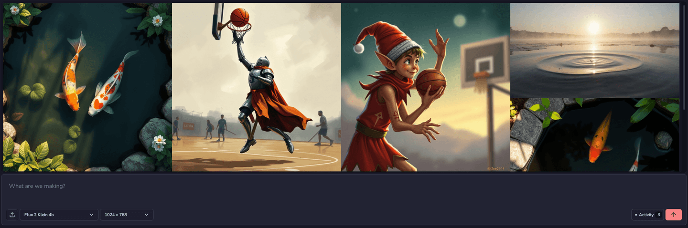
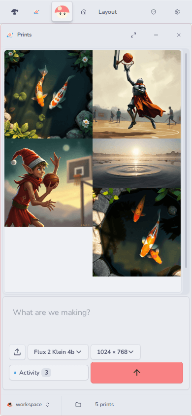

# Prints (`@fungi.computer/prints`)

Prints generates images and video from a prompt and keeps them in a gallery on
your Computer.



Prints is one of the starter Apps of
[Oyster](https://github.com/fungi-computer/oyster), the open App host that runs
on your own Cloudflare account. On Oyster, Prints generates with Workers AI and
saves every file to a folder on the Computer, a Linux workspace in a Cloudflare
Container.

## What you can do

- Type a prompt, pick a model and a size, and generate an image or a video. Each
  file keeps its model's native format: PNG where the model supports it, JPEG
  otherwise, MP4 for video.
- Add your own images as style references, on models that accept them.
- Upload files into the same folder, or choose another folder for the gallery.
- Browse the gallery newest first, open a picture in
  [Inkcap](https://github.com/fungi-computer/inkcap), or open its **Image info**
  panel (press **I**).
- **Download** an image from Image info. The download drops the prompt and
  lineage and keeps the AI marker and the print's id; the file on the Computer
  stays as it is.
- Retry a failed attempt from its tile or from **Activity**, the key in the
  window's status bar. A retry resumes the same attempt instead of generating
  again, and **Resume** picks up an unfinished image after a reload.



## Get it

Prints installs with the other starter Apps. On a deployed Oyster (see the
[Oyster quick start](https://github.com/fungi-computer/oyster#quick-start-deploy-your-own-oyster)),
run:

```sh
export OYSTER_URL=https://oyster.<your-subdomain>.workers.dev
export OYSTER_OWNER_KEY=<your owner key>
npx oyster install-apps
```

The installer clones this repository and the six others, seeds each on your
Oyster with `git push`, builds them on your Computer and installs them. Sign in
at `$OYSTER_URL/login` with the owner key and open Prints from the Tourtois
desktop. Run `install-apps` again to update; each App keeps its data. Generation
uses Workers AI on your Cloudflare account.

## Change it

Every installed App is also a template you can fork on your own Oyster. Fork
Prints into a Bonsai repository and clone it with ordinary `git`:

```sh
curl -X POST -H "Authorization: Bearer $OYSTER_OWNER_KEY" -H 'content-type: application/json' \
  -d '{"appId":"app_prints","name":"my-prints"}' \
  $OYSTER_URL/apps/bonsai/methods/apps.fork
git -c http.extraHeader="Authorization: Bearer $OYSTER_OWNER_KEY" \
  clone $OYSTER_URL/git/bonsai/my-prints.git
```

The reply names your fork's App id and repository. Push your edits, open the
repository in Bonsai and choose **Settings**, then **Build & install** with that
App id and your commit as `git:<sha>`. Install the Release at `prints` to
replace the running Prints, or at a new id to keep both.

To work from GitHub instead, fork this repository and point the installer at
your forks with `--repositories <base URL>` and `--ref <branch or tag>`. The
installer reads all seven starter Apps from that base, so fork them under one
account.

## Agent tools

Agents call Prints through Oyster's MCP endpoint, or at
`POST $OYSTER_URL/apps/prints/methods/<name>` with a key; see
[Git, keys and MCP](https://github.com/fungi-computer/oyster#git-keys-and-mcp).

| Method           | What it does                                                                                                                                 |
| ---------------- | -------------------------------------------------------------------------------------------------------------------------------------------- |
| `listModels`     | Lists the image and video models, with their sizes, settings and how many references each takes.                                             |
| `generateImage`  | Generates one image from a prompt and saves it to the gallery folder. Optional `characters` names saved characters to keep consistent.       |
| `generateVideo`  | Generates one video. While it works, the method returns `{kind: "pending", retryAfterMs}`; call again with the same inputs after that delay. |
| `listCharacters` | Lists the saved characters: name, description and reference image paths. Use the names as `characters` or `@name`.                           |
| `listStyles`     | Lists the saved and built-in styles: name and text. Use a name as `style`.                                                                   |
| `listOutputs`    | Lists the prints this App made, newest first.                                                                                                |
| `getOutput`      | Reads one print by file path: its prompt, model, characters, style and the reference images it used.                                         |
| `openOutput`     | Reads up to 128 KiB of one print per call.                                                                                                   |

Each generation carries a request id (`media_request_` and 21 lowercase letters
or digits). Retrying with the same id and inputs recovers the same generation
instead of paying for another. References are file paths, such as
`[{ path: "/canon/style.png" }]`. In a host with Agent Computer attachments,
`{ computerId: "computer-b", path: "/canon/style.png" }` reads from any attached
Computer using that Computer's own read authorization. Omit `computerId` for the
selected Computer; the output still saves there. Revoked or denied reads stop
generation before provider dispatch. Callers never pass image bytes or URLs.
Reference reads are not confined to the App's library folder: the Computer grant
is the boundary.

`listModels` includes a labelled `priceEstimate` for its stated default settings
(including the example prompt and no references). `basis: "team-price"` includes
the host's current Team markup; `"provider-cost"` is an unmarked provider
estimate. The image result's `costMilliunits` and human-readable `receipt` use
Media's admitted charge, not the catalogue hint. The receipt states that charge
plainly; only `priceEstimate` is an estimate. Changing dimensions, steps, prompt
or references can change the charge.

Set optional `settings.steps` only for models whose `input.steps` is not
`"fixed"`; obey `input.maxSteps` where present. Omission uses the model default.
Refusals retain Media's bounded provider diagnostic. The typed
`provider.reason === "credits_exhausted"` means Cloudflare AI Gateway couldn't
fund the request, not a Team credit refusal. Check the account's credits and
billing in the Cloudflare dashboard under AI Gateway or choose a Workers AI
model; do not retry a `retryable: false` result.

## Build and check

Prints is a React App built with Vite, with controls from
[Caps](https://github.com/fungi-computer/caps). Its backend keeps folder
choices, recovery records and the index of finished prints in the App's own
SQLite database.

```sh
pnpm install
pnpm build
pnpm typecheck
pnpm test
```

[src/MediaPane.tsx](src/MediaPane.tsx) puts the composer, gallery and the
Activity status key together. [src/media-generation.ts](src/media-generation.ts)
owns attempts and retries, [src/media-gallery.ts](src/media-gallery.ts) the
gallery and uploads, and [backend/prints-index.ts](backend/prints-index.ts)
records each finished print. The agent tools are in
[backend/methods.ts](backend/methods.ts), and [package.json](package.json)
declares the permissions the App asks for.

## License

MIT. See [LICENSE](LICENSE).

## This repository

This repository is generated from the App's directory in the Fungi monorepo
for each release. Its `@fungi.computer` dependencies are pinned to their
published versions and `pnpm-lock.yaml` resolves them from npm, so
`pnpm install --frozen-lockfile` and `pnpm build` work here, and
`oyster install-apps` builds it. The App's tests share fixtures with the
rest of the monorepo, so they run there and are not part of this repository.
